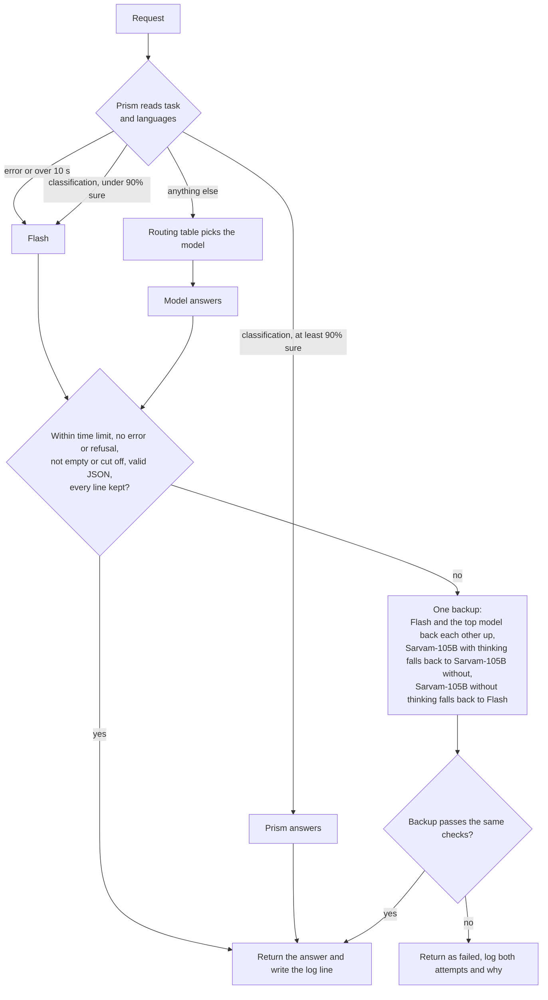

# Model Router

I built a router for Sarvam's inference platform that sends each request to the model best suited to it, in two versions: air-gapped, which uses only models Sarvam serves so it can run inside a customer's own network, and non air-gapped, which can also send the hardest work to Claude Opus 5.5. Both handle back-office work in Hindi, Hinglish, nine regional Indian languages and English.

## Final results

50 held-out requests. Flash and both routers ran three times, the frontier models once. Quality differences are in percentage points, with 95% ranges from resampling the prompts. Monthly cost is the brief's 50 million input and 10 million output tokens (Part 2).

Air-gapped:

| | Quality | Router's difference (95% range) | Cost per 1,000 requests | Monthly cost | p95 latency |
|---|---|---|---|---|---|
| Always GLM-5.3, max thinking | 89.4% | -1.3 (-3.7 to +1.0) | ₹2,757 | ₹10,200 | 173 s |
| **Router** | **88.1%** | | **₹811** | **₹3,677** | **93 s** |
| Always GLM-5.3 Flash | 86.2% | +1.9 (just below 0 to +4.1) | ₹51 | ₹1,125 | 16 s |

Non air-gapped:

| | Quality | Router's difference (95% range) | Cost per 1,000 requests | Monthly cost | p95 latency |
|---|---|---|---|---|---|
| Always Claude Opus 5.5 | 94.6% | -5.6 (-10.6 to -1.8) | ₹3,295 | ₹37,600 | 36 s |
| **Router** | **89.0%** | | **₹1,466** | **₹18,528** | **22 s** |
| Always GLM-5.3 Flash | 86.2% | +2.8 (+0.6 to +5.2) | ₹51 | ₹1,125 | 16 s |

Router against always-frontier:

| | Air-gapped | Non air-gapped |
|---|---|---|
| Monthly saving | 64% (₹6,523) | 51% (₹19,072) |
| Cost per request | 29% of frontier | 44% of frontier |
| Quality | 1.3 points lower (within noise) | 5.6 points lower |
| Quality against Flash | 1.9 points higher (within noise) | 2.8 points higher |
| p95 latency | 54% of frontier | 62% of frontier |
| Failed requests | 0 of 150 | 0 of 150 |
| Backup model used | 2 of 150 | 2 of 150 |
| Prism's share of cost / median time | 0.8% / 0.8 s | 0.4% / 0.8 s |

In short:

- The air-gapped router scores 88.1% against 89.4% for always using GLM-5.3 at max thinking, at 29% of the cost and about half the p95 latency.
- The non air-gapped router gets 94% of always-Opus's quality (89.0% against 94.6%) at 44% of the cost and 62% of the p95 latency.

The sections below follow the brief's questions in order.

---

## Part 1: the router

### 1. Routing policy

Each request first goes to Sarvam Prism, a system one decision model, which in one call names the kind of work (classification, extraction, summary, decision, translation, answer from a document, customer reply, calculation), the language of the request and the language of the answer. A routing table then picks the model, one table for air-gapped and one for non air-gapped. Classifications are answered by Prism itself when it is at least 90% sure, otherwise by Flash. Translations go to Sarvam-105B, with thinking on when translating into a regional language and off when translating out of one. Three tasks go to the top model: decisions, replies and summaries to Opus 5.5, and decisions, replies and calculations to GLM-5.3 at max thinking. Everything else goes to Flash. The answer's format is checked, and if a model fails one backup is tried. Prism costs about ₹0.006 and 0.8 s per request, and that is included in all the figures.

| Request | Air-gapped | Non air-gapped |
|---|---|---|
| Classification, with a label list | Prism (Flash when Prism is under 90% sure) | the same |
| Translation into a regional language | Sarvam-105B, high thinking | the same |
| Translation out of a regional language | Sarvam-105B, thinking off | the same |
| Decision (applying a rule or policy to a case) | GLM-5.3, max thinking | Claude Opus 5.5 |
| Customer reply | GLM-5.3, max thinking | Claude Opus 5.5 |
| Calculation | GLM-5.3, max thinking | GLM-5.3 Flash |
| Summary | GLM-5.3 Flash | Claude Opus 5.5 |
| Extraction, answer from a document | GLM-5.3 Flash | GLM-5.3 Flash |

The code is in [`airgapped/router.py`](airgapped/router.py) and [`nonairgapped/router.py`](nonairgapped/router.py). Each one states its policy at the top and reads in the same order: Prism reads, the table picks, the model answers, the format is checked, and a backup is tried if needed.

### 2. The models, and Indian-language traffic in the test set

The way to approach the problem of model routing was first figuring out the dataset, then what each model's strengths and weaknesses are, and then creating a routing policy. I did not have much data to begin with on what kind of customers are going to use this. The assignment mentions the kind of tasks, but how much error these customers tolerate and what they expect is open ended.

I went through the case studies Sarvam has published about its customers. These gave me an idea of who the customers are, what they are okay with, and what is non negotiable. One of the primary requirements was multilingual capability: most of these companies are deployed at a national scale and need to handle all the Indian languages, in the native language and in mixed language conversations. The others were low cost at national volume, high enough accuracy that humans don't have to redo the task, privacy and security, and auditable interactions.

So based on all of this, I created the held-out set: 24 Hindi and Hinglish banking tasks, generated synthetically and imitating real life scenarios, 8 of them on real RBI circulars. 8 tasks based on real conversations from datasets like IN22-Conv, in Tamil, Telugu, Kannada, Malayalam, Marathi, Bengali, Gujarati and Odia. 18 more items drawn from public datasets (IN22-Conv, XL-Sum, IndicQA, FinanceBench) for conversations, summarising a news article in a different language, retrieval, and multi-step calculations from financial documents.

| | Count |
|---|---|
| Hinglish | 13 |
| Hindi | 11 |
| Regional languages (nine) | 21 |
| English | 5 |
| Extraction, summaries | 9 each |
| Answer from a document, translation | 7 each |
| Decisions, calculations | 5 each |
| Classification, customer replies | 4 each |

I measured every model on the held-out set. Latency runs from sending the request to receiving the whole answer. First answer word is when visible answer text starts, after any thinking.

| Model | ₹ per 1M, in / out | Cost per 1,000 | p50 / p95 | First answer word, p50 | Quality | Over the word limit (median overshoot) | FinanceBench calculations (5) |
|---|---|---|---|---|---|---|---|
| GLM-5.3 Flash (3 runs) | 13.5 / 45 | ₹51 | 3.0 s / 16 s | 1.7 s | 86.2% | 40 of 48 (21%) | 73.3% |
| GLM-5.3, max thinking | 126 / 390 | ₹2,757 | 28 s / 173 s | 27 s | 89.4% | 4 of 16 (4%) | 80.0% |
| Claude Opus 5.5 | 376 / 1,880 | ₹3,295 | 9.5 s / 36 s | 7.8 s | 94.6% | 12 of 16 (7%) | 100% |
| Sarvam Prism | 4 / 0 | ₹6 | 0.82 s / 2.2 s | | named the task on 147 of 150; 9 of 9 classifications right | | |

The routers send Sarvam-105B (₹15 / ₹60 per 1M) only translations, so it was measured only on the 7 regional-language conversations, inside the routers:

| Model | Cost per 1,000 translations | p50 | Quality |
|---|---|---|---|
| GLM-5.3 Flash | ₹115 | 10 s | 72.6% |
| Sarvam-105B, thinking off (out of a regional language) | ₹49 | 3.2 s | 78.8% across both directions* |
| Sarvam-105B, high thinking (into a regional language) | ₹298 | 18 s | (same figure) |
| GLM-5.3, max thinking | ₹5,439 | 116 s | 85.7% |
| Claude Opus 5.5 | ₹7,253 | 28 s | 100% |

\* Covers the 39 answers Sarvam-105B gave, not 3 more whose broken line structure sent the request to Flash.

GLM-5.3 at max scores 3.2 points above Flash overall (89.4% against 86.2%), but costs 54 times as much and thinks for about 27 s before writing its first word, against 1.7 s for Flash. It is stronger on decisions (93% against 82%), translation (85.7% against 72.6%) and calculations (80% against 73%), and it keeps to word limits far better: Flash went over on 40 of its 48 limited answers. Sarvam-105B costs about the same per token as Flash. On translations, with thinking off it is cheaper and faster than Flash (₹49 and 3.2 s against ₹115 and 10 s); with high thinking it costs more and is slower (₹298 and 18 s). On quality it is level with Flash once its 3 broken answers count as failures (73.2% against 72.6%).

Prices are Sarvam's list prices (12 November 2026), and OpenRouter's for Opus, converted at ₹94 to the dollar, excluding GST. Thinking tokens are billed as output.

### 3. Logging, timeouts and refusals

Every request writes one log line with Prism's three picks, the route and the rule that chose it, every attempt with its status, tokens, cost and time, whether a backup fired and why, the router's own cost and time, and the quality score. It does not record how confident Prism was in the three picks, only on classifications, and it does not keep the text of a failed first attempt.

| Failure | What the router does |
|---|---|
| Prism errors or takes more than 10 s | the request goes to Flash |
| A model takes longer than its task's time limit (60 s for extraction up to 420 s for a customer reply), errors, refuses, returns nothing, is cut off, returns an extraction that is not valid JSON, or a translation that lost or merged lines | one backup is tried: Flash and the top model back each other up; Sarvam-105B with thinking falls back to Sarvam-105B without thinking; Sarvam-105B without thinking falls back to Flash |
| The backup fails too | the request is returned as failed, and logged with both attempts and the reason for each |
| Prism is not sure of a classification | Flash answers it (logged separately, not counted as a failure) |



In the test runs no request failed, and the backup fired 4 times, all on translations that broke the structure check (h38 three times, h36 once). Here is one of them, request h38, a Malayalam to English translation, shortened (some fields left out, times rounded; the full line is in `nonairgapped/logs/run1/router.jsonl`):

```json
{
  "id": "h38",
  "route": "sarvam",
  "reason": "translation out of a regional language: Sarvam-105B, thinking off",
  "labels": {"task": "translate", "language": "regional", "answer_language": "english"},
  "model": "glm5.3-flash",
  "attempts": [
    {"model": "sarvam-105b", "status": "bad_format", "tokens_in": 1140, "tokens_out": 792, "cost": 0.06462, "latency": 4.36},
    {"model": "glm5.3-flash", "status": "ok", "tokens_in": 5654, "tokens_out": 765, "cost": 0.110754, "latency": 5.91}
  ],
  "router_cost": 0.006272,
  "router_latency": 0.72,
  "cost": 0.181646,
  "latency": 11.0,
  "fallback": true,
  "fallback_reason": "bad_format",
  "quality": 1.0
}
```

Sarvam-105B's answer failed the line check, Flash answered as the backup, and both attempts were billed. The totals, ₹0.182 and 11.0 s, include Prism's ₹0.006 and 0.72 s.

### 4. Baselines

These are on the 50 held-out requests. Flash and both routers were run three times, the frontier models once. Quality is the share of marks earned, and differences are in percentage points. 16 prompts have a word limit, and an answer over its limit loses marks.

Air-gapped, against always using GLM-5.3 at max thinking:

| | Quality | Cost per 1,000 requests | p95 latency |
|---|---|---|---|
| Always frontier (GLM-5.3, max thinking) | 89.4% | ₹2,757 | 173 s |
| Router | 88.1% | ₹811 (29% of frontier) | 93 s (54% of frontier) |
| Always cheapest (GLM-5.3 Flash) | 86.2% | ₹51 (2% of frontier) | 16 s |

Non air-gapped, against always using Claude Opus 5.5:

| | Quality | Cost per 1,000 requests | p95 latency |
|---|---|---|---|
| Always frontier (Claude Opus 5.5) | 94.6% | ₹3,295 | 36 s |
| Router | 89.0% | ₹1,466 (44% of frontier) | 22 s (62% of frontier) |
| Always cheapest (GLM-5.3 Flash) | 86.2% | ₹51 (2% of frontier) | 16 s |

By task:

| Task | Requests | Always Opus | Non air-gapped router | Always GLM-5.3 max | Air-gapped router | Always Flash |
|---|---|---|---|---|---|---|
| Classification | 4 | 100% | 100% | 100% | 100% | 100% |
| Extraction | 9 | 100% | 100% | 98% | 100% | 100% |
| Answer from a document | 7 | 95% | 93% | 95% | 95% | 96% |
| Calculation | 5 | 100% | 80% | 80% | 80% | 73% |
| Decision | 5 | 81% | 79% | 93% | 86% | 82% |
| Summary | 9 | 85% | 84% | 80% | 81% | 80% |
| Customer reply | 4 | 100% | 94% | 86% | 85% | 82% |
| Translation | 7 | 100% | 81% | 86% | 77% | 73% |

How much room each router had. The oracle takes the best score any model in the pool got on each prompt, so it is the most any router choosing between these models could reach.

| | Air-gapped | Non air-gapped |
|---|---|---|
| Oracle (best model per prompt) | 91.2% | 96.8% |
| Room above Flash | 5.0 points | 10.6 points |
| What the router took of that room | 1.9 points (38%) | 2.8 points (26%) |
| Left between router and oracle | 3.1 points | 7.8 points |

What the quality measure does not capture:

- Extraction, classification and calculations are checked exactly. Everything else is checked by a judge model (OpenAI's gpt-6.1-sol, from a maker not under test) against a list of facts a correct answer must contain, or for translations against a human reference. On answers whose correct score was known, the judge got 411 of 412 fact decisions right. It judges meaning, not fluency, tone or politeness.
- Harm is not weighted: a missing EMI date and a missing pleasantry cost the same mark.
- There is only one right answer per prompt, so answers that are right in an unexpected way can lose marks.
- Times are from a laptop and include about 0.7 s of network travel per model call.
- 32 of the 50 prompts were written by a model (OpenAI Codex, so as not to favour the Claude model under test): 24 outright, 8 of them on real RBI circulars, plus the task and expected answer for 8 real conversations. They were then checked by a second pass. These prompts are cleaner than real traffic.

### 5. Stack, trade-offs, and running in a VPC or air-gapped

Python 3.12, the OpenAI client library (Sarvam's API and OpenRouter both speak its format), and httpx for Prism's endpoint. No framework. The routing policies are in `airgapped/` and `nonairgapped/`, shared code (models and prices, Prism, format checks, the grader) in `common/`, and the test set in `dataset/`.

```
pip install -r requirements.txt
cp .env.example .env                     # then add SARVAM_API_KEY and OPENROUTER_API_KEY
python evaluate.py baselines             # always-Flash, always-GLM-5.3, always-Opus on the test set
python evaluate.py airgapped 1           # a router, run 1 (2, 3 for repeats)
python evaluate.py nonairgapped 1
python report.py airgapped               # writes airgapped/results/summary.md
python -m airgapped.router "Translate into Tamil: your loan is approved."
```

Trade-offs considered and dropped:

| Tried | What happened | Why dropped |
|---|---|---|
| Routing on how hard a request is | Flash's gap to Opus was about the same on the easier and the harder prompts of the design sets | Difficulty did not predict where Flash loses; the task and the language did, and Prism names those reliably |
| A table of "the cheapest model that scored best on each task", chosen from the first set | 98.6% on the set it was tuned on, 91.4% on the next (Flash: 90.5%) | Chosen from 4 to 10 prompts per task; it did not survive fresh prompts |
| A middle tier: GLM-5.3 at max for replies and summaries, or Gemma 4 and DeepSeek V4.1 Flash | GLM-5.3: 91.0% against Flash's 89.2% at 15 times the cost and a 93 s p95. Gemma 4: 12 of 12 on replies in one set, 57% in the next | Not worth the price and wait, or did not hold up |
| Flash first, Prism checks the answer, doubtful answers go up | With Opus on top: 93.9% at ₹1,140 per 1,000 on the second set. With GLM-5.3 on top, on the held-out set: the same score with or without escalating | Prism's confidence barely separated complete answers from incomplete ones on new prompts, and GLM-5.3's rewrites were as often worse as better |
| Opus for translation | Opus got every translation right | ₹7 to ₹9 per conversation; Sarvam-105B with the free structure check gets most of the way |

Running inside a customer's VPC or air-gapped. The air-gapped router uses only open-weight models served by Sarvam and Prism, so nothing leaves the customer's network.

---

## Part 2: monthly cost at 50 million input and 10 million output tokens

I priced the same month two ways, both from the held-out set's measured mix of models.

The first is as the brief states it: 1 output token for every 5 input tokens, applied to every model, including each model inside the router. Each model gets the share of the router's input it handled in the logs (backup attempts included) and the same share of the output: air-gapped, Flash 68.1%, GLM-5.3 26.3%, Sarvam-105B 5.6%; non air-gapped, Flash 47.7%, Opus 47.3%, Sarvam-105B 5.1%. Prism's reading is added on top, 0.78 and 0.74 tokens per model token, at ₹4 per million.

| | Air-gapped | Saved against always-frontier | Non air-gapped | Saved against always-frontier |
|---|---|---|---|---|
| Always frontier | ₹10,200 (GLM-5.3) | | ₹37,600 (Opus 5.5) | |
| Router | ₹3,677 | 64% | ₹18,528 | 51% |
| Always cheapest (Flash) | ₹1,125 | 89% | ₹1,125 | 97% |

The second is at the output each configuration really produces: the same traffic (50M input tokens of requests, about 23,000 requests of the test set's mix), with output as measured, thinking included.

| | Air-gapped | Saved against always-frontier | Non air-gapped | Saved against always-frontier |
|---|---|---|---|---|
| Always frontier | ₹63,959 (GLM-5.3) | | ₹76,448 (Opus 5.5) | |
| Router | ₹18,815 | 71% | ₹34,019 | 55% |
| Always cheapest (Flash) | ₹1,186 | 98% | ₹1,186 | 98% |

Assumptions:

- Thinking is billed as output, and it breaks the 10M assumption. GLM-5.3 at max wrote 3 output tokens for every input token, 93% of them thinking, so its real bill is six times the brief's arithmetic. Flash wrote 0.23.
- The figures assume the held-out set's mix of tasks. More replies and summaries raise the non air-gapped router's cost; more extraction and classification lower it.
- Prism is about 4% of the air-gapped router's cost and 0.8% of the non air-gapped router's in the first table, and 0.8% and 0.4% in the second.
- OpenRouter's 5.5% fee on buying credits is not included; it would add about ₹2,000 to always-Opus in the first table.
- List prices, excluding GST, with no volume discount, at ₹94 to the dollar. Cached input barely moves these figures because few test requests repeat the same opening.

---

## Part 3: business questions

The brief numbers its questions 1 to 5, 7 and 8; I kept its numbering.

**1. Pick one pricing approach for a ₹2 crore a year BFSI account and defend it. Blended per-token rate, per-model pass-through with a margin, a platform subscription, or outcome pricing?**

Enterprises are restricting AI usage because of costs, but don't want inferior models. I would choose a platform subscription with committed inference capacity and FDE support. Blended token pricing exposes us to unpredictable model costs, per-model pass-through exposes our markup and invites competitors to undercut us, while outcome pricing makes measurement hard and savings difficult to attribute. A platform lets us charge for continuous optimisation and engineering support, with usage limits protecting our margins and predictable spending for the customer.

**2. Routing shrinks the tokens you bill. Make the case for building it anyway, or argue that we should not.**

Token usage does not translate directly into business output. Beyond a point, spending more on intelligence gives diminishing returns, and as cheaper models improve, paying frontier prices for routine tasks becomes harder to justify. Customers will find ways to cut these costs, either by building routing themselves or using another provider. If Sarvam doesn't offer it, we risk losing that traffic altogether. Cheaper inference also makes more workloads affordable, giving customers room to use AI more often. Even if we earn less per request, retaining these customers and handling a larger share of their workloads could be worth much more over time.

**3. Your router saves 55% but adds 120ms at p95 and loses 3% of quality on the hardest tenth of queries. Which customers is that wrong for, and what would you put in the contract?**

This would be a bad trade-off for customers where mistakes are expensive, such as banks using AI for underwriting, financial disputes or regulatory decisions. The additional 120ms could also be a problem for real-time voice agents where delays are noticeable. I would set different quality and latency requirements for each workload rather than promising one SLA across everything. High-stakes queries should go directly to the frontier model, with human review where necessary. The contract should define minimum quality thresholds, p95 latency limits, audit logs and automatic rollback if performance drops below agreed levels, with service credits for violations.

**4. A CTO says "we will just send everything to the frontier model and eat the cost". Give your three-sentence answer, and the one discovery question you would ask first.**

That's reasonable if the frontier model reduces enough human work to justify its cost, because inference is only one part of the cost of completing a task. But not every task benefits equally from additional intelligence, and using a frontier model for routine work where cheaper models perform just as well is money your competitors will save and use to improve their margins or offer lower prices. I would benchmark the total cost per successful task, including human review and corrections, and use frontier models wherever their additional intelligence justifies the expense.

**Discovery question:** Which tasks have seen the biggest reduction in human intervention from using frontier models, and how are you measuring that?

**5. OpenRouter, Not Diamond, Martian and every hyperscaler offer routing. Where does Sarvam win structurally, and where does it lose?**

OpenRouter has wider model access, Not Diamond and Martian specialise in routing intelligence, and hyperscalers already have enterprise relationships and infrastructure at scale. Sarvam's advantage is in India, with its own Indic models, locally hosted inference, multilingual capabilities and the ability to deploy inside a customer's VPC or air-gapped environment. For Indian banks and government customers dealing with multilingual data and strict security requirements, having one provider inside India handle models, inference and deployment is valuable. This also extends to global companies looking to serve Indian users in their native languages. Sarvam loses on global model coverage, frontier model access and infrastructure scale.

**7. Pick one Indian segment. What is the first workload you route, what proof do you need by the end of week two, and what takes this from a pilot to ₹10 crore of run-rate?**

I would target large retail NBFCs, where millions of customer conversations happen across Indian languages. Bajaj Finance has already analysed 20 million calls using AI, so the demand exists. I'd start with post-call intelligence for loan sales, extracting customer intent, summarising conversations and identifying leads. By week two, I'd want results on real anonymised calls showing cost per correctly processed conversation, accuracy, human corrections and latency against existing solutions. To reach ₹10 crore run-rate, I'd expand into servicing and collections, then replicate the deployment across five ₹2 crore accounts, provided the pilot proves both customer ROI and Sarvam's margins.

**8. Six months in, quality quietly degrades on a customer's most valuable 5% of queries and their users notice before you do. What can you do to ensure the customer does not churn away?**

If users noticed before us, we've already lost some of the customer's trust. I would immediately move the affected queries to the last proven model, absorbing the additional cost ourselves, and have an FDE work with their team to identify and fix the problem. I'd offer service credits for the disruption and share a clear timeline for recovery. To regain their confidence, I'd give the customer visibility into quality metrics, run regular evaluations on their most valuable workloads and establish automatic rollback thresholds. The customer needs to see that we're taking responsibility, that their business isn't suffering, and that this won't happen again.